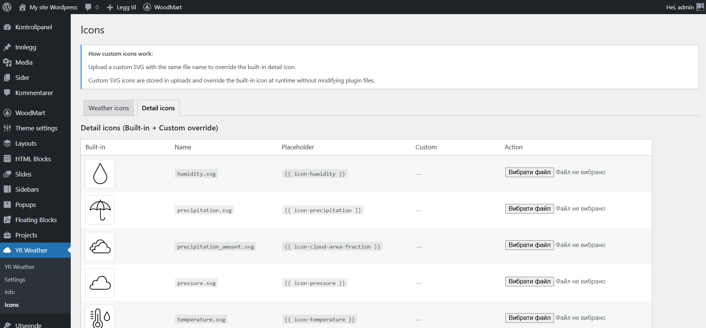
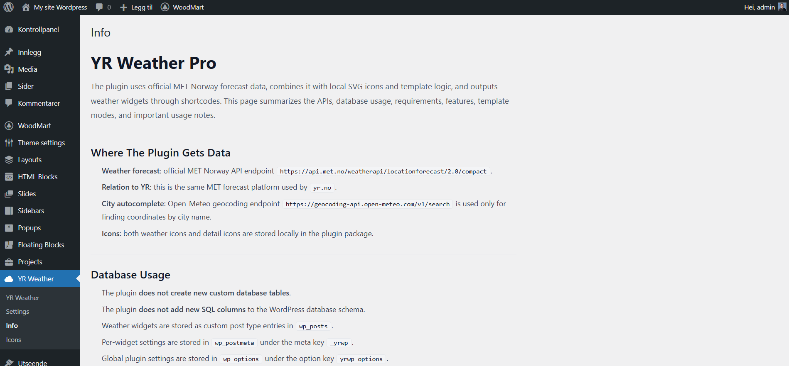

# YR Weather Pro

## 1. Що це таке і для чого цей плагін

**YR Weather Pro** — це WordPress-плагін для створення погодних віджетів на основі даних сервісу **MET Norway / yr.no**. Плагін дозволяє адміністратору створювати кілька окремих погодних блоків, налаштовувати для кожного джерело координат, період прогнозу, шаблон відображення, набір полів, стилі та спосіб виводу на сайт.

Плагін створений для випадків, коли потрібно:

- показувати поточну погоду або прогноз на кілька днів;
- використовувати кілька незалежних віджетів на одному сайті;
- вставляти погоду в сторінки, записи або шаблони через shortcode;
- працювати як із фіксованою локацією, так і з геолокацією відвідувача;
- мати готові шаблони та можливість повністю керувати HTML через Manual templates;
- замінювати стандартні SVG-іконки на власні;
- кешувати відповіді API через WordPress Transients;
- працювати з API-даними також через REST endpoint.

Плагін не є “простим віджетом” у вузькому значенні. По суті це невелика система керування погодними блоками, побудована на базі власного **Custom Post Type** `yrwp_widget`.

## 2. Звідки плагін бере інформацію

Плагін використовує два зовнішні API:

### 2.1. Прогноз погоди

- Основне API прогнозу: `https://api.met.no/weatherapi/locationforecast/2.0/compact`
- Реалізація запиту: `includes/class-yrwp-met.php`
- Метод: `MET::fetch_compact(float $lat, float $lon)`

Що робить:

- формує URL із `lat` та `lon`;
- виконує `wp_remote_get()`;
- передає власний `User-Agent`;
- декодує JSON-відповідь;
- повертає нормалізований масив `['ok' => true|false, ...]`.

### 2.2. Пошук міста та зворотне визначення timezone

- Пошук міста: `https://geocoding-api.open-meteo.com/v1/search`
- Reverse geocoding: `https://geocoding-api.open-meteo.com/v1/reverse`
- Реалізація:
  - `Admin::ajax_city_search()` у `includes/class-yrwp-admin.php`
  - `MET::fetch_timezone_for_coordinates()` у `includes/class-yrwp-met.php`

Що використовується:

- для автодоповнення міста в адмінці;
- для збереження `city_lat`, `city_lon`, `city_timezone`;
- для визначення timezone локації, щоб підтримувати токени поточного локального часу.

## 3. Загальна архітектура плагіну

Точка входу плагіну:

- `yr-weather-pro.php`

Під час `plugins_loaded` викликається `yrwp_boot()`, який ініціалізує `\YRWP\Plugin::instance()`.

Основний bootstrap:

- `includes/class-yrwp-plugin.php`

Він підключає і запускає:

- `CPT::init()` — реєстрація типу запису погодних віджетів;
- `Admin::init()` — меню налаштувань, global options, AJAX пошуку міста;
- `Icons::init()` — сторінка кастомних іконок;
- `Shortcode::init()` — shortcode `[yr_weather id="..."]` і фронтенд-скрипти;
- `Rest::init()` — REST endpoints для погоди та даних.

## 4. Основна логіка роботи

### 4.1. Модель даних

Плагін зберігає дані у двох місцях:

- **Global settings** у `wp_options`, ключ: `yrwp_options`
- **Widget settings** у `wp_postmeta`, meta key: `_yrwp`

У `yrwp_options` зберігаються:

- `language`
- `user_agent_email`
- `access_key`

У `_yrwp` для кожного погодного віджета зберігаються:

- `enabled`
- `title_show`
- `location_mode`
- `lat`, `lon`
- `city_name`, `city_lat`, `city_lon`, `city_timezone`
- `refresh`
- `period`
- `template_map`
- `custom_class`
- `custom_css`
- `custom_short_text`
- `custom_long_text`
- `manual_templates`
- `today_manual_step`
- `manual_show_units`
- `manual_show_today_7`
- `manual_show_today_9`

### 4.2. Примітивна активація через access key

У поточній реалізації плагін вимагає введення **будь-якого рядка з 32 символів** у глобальних налаштуваннях.

Що це означає:

- якщо `access_key` порожній або не дорівнює 32 символам, плагін вважається неактивним;
- якщо ключ введено, поле блокується в адмінці;
- плагін не є ліцензійною системою з серверною перевіркою;
- це локальна обов’язкова умова для запуску функціоналу.

Де це перевіряється:

- `Admin::has_valid_access_key()`
- `Shortcode::render()`
- `Rest::get_weather()`
- `Rest::get_weather_data()`
- `MET::fetch_compact()`
- `MET::fetch_timezone_for_coordinates()`
- `Admin::ajax_city_search()`

Наслідок:

- без ключа не працює рендер погоди;
- без ключа не працює geocoding;
- без ключа REST повертає помилку;
- без ключа shortcode нічого не відображає.

### 4.3. Життєвий цикл погодного віджета

1. Адміністратор створює запис типу `yrwp_widget`.
2. У метабоксі налаштовує період, шаблон, координати, кеш, ручні шаблони тощо.
3. Плагін зберігає мета-дані у `_yrwp`.
4. Адміністратор вставляє shortcode `[yr_weather id="ID"]`.
5. При рендері shortcode:
   - віджет завантажується через `get_post()`;
   - зчитується meta через `CPT::get_meta()`;
   - перевіряється `enabled`;
   - визначається active template;
   - визначається джерело координат;
   - завантажуються або кешовані, або нові погодні дані;
   - дані передаються у template loader.
6. На фронтенді HTML повертається в сторінку або, для visitor geolocation, догружається через REST.

### 4.4. Кешування

Плагін активно використовує **WordPress Transients**.

Типи кешу:

- погодні дані віджета: `yrwp_cache_{widget_id}_{md5(lat:lon)}`
- timezone за координатами: `yrwp_timezone_{md5(lat:lon)}`

Особливості:

- `refresh` задається в секундах;
- мінімальний TTL у коді для погоди: `max(60, $ttl)`;
- timezone кешується на `WEEK_IN_SECONDS * 4`;
- при збереженні віджета викликається `delete_transient('yrwp_cache_' . $post_id)`, але основний runtime cache будується з додатковим hash координат, тому очищення тут часткове, а не повне.

### 4.5. Геолокація відвідувача

Якщо для віджета обрано `visitor_geo`:

- shortcode виводить контейнер у стані loading;
- `assets/frontend.js` запитує `navigator.geolocation`;
- після отримання координат викликається REST endpoint `yrwp/v1/weather`;
- у відповідь повертається готовий HTML віджета;
- HTML вставляється в DOM.

### 4.6. Локалізація

Плагін підтримує три мови:

- English (`en`)
- Norsk Bokmal (`nb`)
- Українська (`uk`)

Клас:

- `includes/class-yrwp-i18n.php`

Він відповідає за:

- текстові переклади UI;
- назви параметрів погоди;
- описи symbol codes;
- форматування значень;
- форматування дат, коротких дат і назв днів тижня;
- вміст сторінки Info;
- підказки для токенів Manual templates.

## 5. Всі можливості плагіну

### 5.1. Кілька погодних віджетів

Плагін працює через `Custom Post Type`:

- `yrwp_widget`

Це означає:

- можна створити багато погодних блоків;
- кожен блок має власну конфігурацію;
- кожен блок має власний shortcode;
- віджети не залежать один від одного.

### 5.2. Періоди прогнозу

Підтримуються 4 режими:

- `current` — поточна погода
- `today` — погодинний прогноз на сьогодні
- `7` — прогноз на 7 днів
- `9` — прогноз на 9 днів

### 5.3. Шаблони відображення

Для кожного періоду є 4 типи шаблонів:

- `default`
- `compact`
- `manual`
- `json`

Що це означає:

- **default** — стандартний HTML-шаблон плагіну;
- **compact** — компактний варіант дизайну;
- **manual** — повністю керований HTML через токени;
- **json** — повернення JSON-представлення даних замість звичайного HTML.

### 5.4. Manual templates

Manual templates — одна з ключових можливостей плагіну.

Адміністратор може задавати власний HTML для:

- `current`
- `today`
- `today_item`
- `7`
- `7_item`
- `9`
- `9_item`

Особливості:

- шаблони редагуються прямо в адмінці;
- в шаблонах не виконується PHP;
- використовується підстановка токенів `{{ ... }}`;
- є довідка по доступних токенах;
- токени можна копіювати кліком;
- для HTML і CSS використовується WordPress Code Editor.

Приклади токенів:

- `{{ title }}`
- `{{ weather_icon }}`
- `{{ weather_text }}`
- `{{ temperature }}`
- `{{ wind }}`
- `{{ humidity }}`
- `{{ pressure }}`
- `{{ forecast-time }}`
- `{{ updated_at }}`
- `{{ hourly_blocks }}`
- `{{ daily_blocks }}`
- `{{ now-time }}`
- `{{ location-now-time }}`

### 5.5. JSON templates

JSON templates дозволяють використовувати віджет як джерело структурованих даних.

Доступні шаблони:

- `template-current-json.php`
- `template-today-json.php`
- `template-7-json.php`
- `template-9-json.php`

Сценарії використання:

- інтеграція з іншим фронтендом;
- headless або hybrid рендеринг;
- дебаг структури прогнозу;
- передача погодних даних у кастомні компоненти.

### 5.6. Кастомні CSS-стилі

Для не-JSON шаблонів можна додати власний CSS:

- поле `custom_css`
- на фронтенді цей CSS інлайниться у `<style>`

Також можна додати:

- `custom_class` — свій CSS-клас для контейнера віджета

### 5.7. Кастомні тексти

Для Manual режимів доступні:

- `Short text`
- `Long text`

`Long text` редагується через `wp_editor()`, тому підтримує базове форматування WordPress.

### 5.8. Іконки

Плагін має дві категорії SVG-іконок:

- **Weather icons** — погодні іконки MET symbol code
- **Detail icons** — іконки деталей: температура, вітер, вологість, тиск тощо

Можливості:

- використання вбудованих SVG;
- перевизначення кастомними SVG із uploads;
- заміна іконки без редагування файлів плагіну;
- окрема сторінка адміністрування іконок;
- safe sanitization SVG перед збереженням.

### 5.9. Автопошук міста

Для `location_mode = city` доступний пошук міста:

- введення рядка;
- AJAX у WordPress admin;
- звернення до geocoding API;
- підстановка `city_name`, `city_lat`, `city_lon`, `city_timezone`.

### 5.10. Browser geolocation

Є два сценарії:

- у редакторі віджета кнопка `Use my current location` підставляє координати в поля;
- у frontend-режимі `visitor_geo` координати отримуються з браузера відвідувача і прогноз підвантажується через REST.

### 5.11. Theme override шаблонів

Плагін підтримує перевизначення template-файлів темою.

Шлях перевизначення:

- `/wp-content/themes/your-theme/yr-weather-pro/template-{slug}.php`

Якщо файл існує в темі, він має пріоритет над файлом у плагіні.

## 6. Де і як працює рендеринг

Основний рендеринг виконується в:

- `includes/class-yrwp-shortcode.php`

Ключові задачі цього класу:

- реєстрація shortcode;
- підключення frontend CSS/JS;
- вибір template-файлу;
- fallback на default template;
- збагачення meta timezone-даними;
- побудова JSON payload;
- render helper functions;
- обробка Manual token placeholders;
- оновлення live-time token у браузері.

### 6.1. Джерела координат

Підтримуються 3 режими:

- `manual_coords`
- `city`
- `visitor_geo`

Логіка:

- `manual_coords` бере `lat/lon` з мета-полів;
- `city` бере `city_lat/city_lon`;
- `visitor_geo` не рендерить прогноз одразу, а чекає координати від браузера.

### 6.2. Що рендериться на фронтенді

Плагін виводить:

- контейнер віджета;
- title віджета, якщо включено;
- custom CSS, якщо шаблон не JSON;
- далі або HTML, або JSON, залежно від template mode;
- при visitor geolocation — loading state і подальшу вставку HTML через JS.

## 7. REST API плагіну

Клас:

- `includes/class-yrwp-rest.php`

### 7.1. Endpoint для HTML погоди

Маршрут:

- `GET /wp-json/yrwp/v1/weather`

Параметри:

- `id` — обов’язковий ID віджета
- `lat` — обов’язкова широта
- `lon` — обов’язкова довгота

Повертає:

- `ok`
- `html`
- або `error`

Сценарій використання:

- visitor geolocation на фронтенді

### 7.2. Endpoint для структурованих даних

Маршрут:

- `GET /wp-json/yrwp/v1/data`

Параметри:

- `id` — обов’язковий
- `period` — необов’язковий
- `lat`, `lon` — необов’язкові

Повертає:

- JSON payload для потрібного періоду

## 8. Адмін-меню плагіну

Top-level menu:

- **YR Weather**

Всередині меню працюють такі пункти:

### 8.1. Settings

Slug:

- `yrwp_main`

Призначення:

- глобальні налаштування плагіну

Поля:

- `Language`
- `Contact email for User-Agent`
- `Access key`

Логіка:

- language впливає на тексти плагіну;
- email додається в User-Agent для MET API;
- access key обов’язковий для роботи плагіну;
- після введення валідного ключа поле блокується.


### 8.2. Weather Widgets (CPT list)

Тип запису:

- `yrwp_widget`

У меню WordPress цей тип запису з’являється як підрозділ у `YR Weather`.

Звідси доступні:

- список усіх погодних віджетів;
- редагування існуючого віджета;
- створення нового віджета;
- shortcode в колонці списку.


### 8.3. Екран редагування віджета

Це найважливіший інтерфейс плагіну.

Основний метабокс `Widget Settings` містить:

- `Enabled`
- `Forecast period`
- `Template`
- `Location source`
- `City`
- `Manual coordinates`
- `Update frequency`
- `Show title`
- `Custom CSS class`
- `Custom CSS`
- `Manual template` поля для різних періодів
- `Hourly block template`
- `Day block template`
- `Measurement units`
- `Show today day`
- `Short text`
- `Long text`

Окремий sidebar-метабокс:

- shortcode з кнопкою копіювання

Інтерфейс динамічно приховує або показує поля залежно від:

- вибраного періоду;
- вибраного template mode;
- вибраного source mode.

Наприклад:

- Manual-поля показуються лише для шаблону `*-manual`;
- custom CSS ховається для JSON template;
- city fields показуються лише для `city`;
- lat/lon поля показуються лише для `manual_coords`.


### 8.4. Icons

Slug:

- `yrwp_icons`

Призначення:

- перегляд вбудованих SVG;
- завантаження custom SVG;
- перевизначення built-in іконок;
- видалення custom override;
- окремі вкладки для weather icons і detail icons.

Tabs:

- `Weather icons`
- `Detail icons`

Особливості:

- custom SVG зберігаються в uploads;
- built-in файли плагіну не змінюються;
- detail icons показують відповідний placeholder token;
- SVG санітизуються перед збереженням.




### 8.5. Info

Slug:

- `yrwp_info`

Призначення:

- показати пояснення по плагіну;
- описати API, шляхи до іконок, технічну довідку;
- вивести version footer і branding.

Контент сторінки формується з:

- `I18N::info_content()`



## 9. Структура плагіну

Нижче наведена актуальна структура на рівні основних директорій і ключових файлів:

```text
yr-weather-pro-8.3/
├── README-1.md
├── README.md
├── uninstall.php
├── yr-weather-pro.php
├── assets/
│   ├── admin.js
│   ├── frontend.js
│   ├── images/
│   │   ├── Relevant-logo.png
│   │   ├── screen-1.png
│   │   ├── screen-2.png
│   │   ├── ...
│   ├── icons/
│   │   ├── details/
│   │   │   ├── humidity.svg
│   │   │   ├── pressure.svg
│   │   │   ├── temperature.svg
│   │   │   ├── wind_direction.svg
│   │   │   ├── wind_speed.svg
│   │   │   └── ...
│   │   └── weather/
│   │       └── svg/
│   │           ├── clearsky_day.svg
│   │           ├── cloudy.svg
│   │           ├── rain.svg
│   │           └── ... багато SVG-іконок погоди
│   └── style/
│       ├── admin.css
│       ├── frontend.css
│       └── templates/
│           ├── template-7-compact.css
│           ├── template-7-default.css
│           ├── template-9-compact.css
│           ├── template-9-default.css
│           ├── template-current-compact.css
│           ├── template-current-default.css
│           ├── template-default.css
│           ├── template-today-compact.css
│           └── template-today-default.css
├── includes/
│   ├── class-yrwp-admin.php
│   ├── class-yrwp-cpt.php
│   ├── class-yrwp-i18n.php
│   ├── class-yrwp-icons.php
│   ├── class-yrwp-met.php
│   ├── class-yrwp-plugin.php
│   ├── class-yrwp-rest.php
│   ├── class-yrwp-shortcode.php
│   └── manual-token-help-map.php
└── templates/
    ├── template-current-default.php
    ├── template-current-compact.php
    ├── template-current-manual.php
    ├── template-current-json.php
    ├── template-today-default.php
    ├── template-today-compact.php
    ├── template-today-manual.php
    ├── template-today-json.php
    ├── template-7-default.php
    ├── template-7-compact.php
    ├── template-7-manual.php
    ├── template-7-json.php
    ├── template-9-default.php
    ├── template-9-compact.php
    ├── template-9-manual.php
    ├── template-9-json.php
    ├── template-default.php
    └── template-compact.php
```

## 10. Призначення основних файлів

### `yr-weather-pro.php`

- заголовок плагіну;
- константи шляху і URL;
- boot logic.

### `includes/class-yrwp-plugin.php`

- підключення всіх основних класів;
- централізований запуск плагіну;
- helper для template locate/render.

### `includes/class-yrwp-admin.php`

- реєстрація меню Settings та Info;
- global settings;
- access key логіка;
- AJAX geocoding пошуку міста;
- enqueue admin assets.

### `includes/class-yrwp-cpt.php`

- реєстрація `yrwp_widget`;
- метабокси;
- збереження meta;
- shortcode box;
- template preview modal;
- довідка для Manual tokens.

### `includes/class-yrwp-shortcode.php`

- frontend rendering;
- template loading;
- manual token interpolation;
- JSON payload builder;
- render helper methods;
- live time token support.

### `includes/class-yrwp-rest.php`

- REST routes;
- REST responses для HTML і JSON;
- resolve widget context;
- resolve coordinates.

### `includes/class-yrwp-met.php`

- інтеграція з зовнішніми API;
- User-Agent;
- fetch compact forecast;
- timezone lookup;
- transient cache.

### `includes/class-yrwp-icons.php`

- іконки weather/detail;
- custom overrides;
- upload/delete SVG;
- sanitization SVG.

### `includes/class-yrwp-i18n.php`

- переклади;
- форматування;
- довідковий контент сторінки Info;
- назви полів і описів погоди.

### `assets/admin.js`

- ініціалізація Code Editor;
- autocomplete міст;
- browser geolocation для полів lat/lon;
- копіювання токенів;
- копіювання shortcode;
- preview modal шаблонів.

### `assets/frontend.js`

- visitor geolocation;
- виклик REST endpoint;
- підстановка HTML;
- підтримка live time token в браузері.

### `uninstall.php`

- видаляє `yrwp_options`;
- видаляє всі записи `yrwp_widget`;
- видаляє transient cache;
- очищає також site option / multisite transient records.

## 11. Шаблони та стилі

### 11.1. PHP templates

Директорія:

- `templates/`

Містить шаблони для:

- current
- today
- 7 days
- 9 days
- default / compact / manual / json

### 11.2. CSS templates

Директорія:

- `assets/style/templates/`

Містить окремі стилі для більшості default/compact шаблонів. Це дозволяє не навантажувати один універсальний CSS великою кількістю умов.

## 12. Де зберігаються іконки

Built-in іконки:

- weather: `assets/icons/weather/svg/`
- details: `assets/icons/details/`

Custom overrides:

- weather: `wp-content/uploads/yrwp-icons/`
- details: `wp-content/uploads/yrwp-detail-icons/`

Принцип роботи:

- якщо в uploads існує файл з тим самим ім’ям, він має пріоритет;
- якщо custom файла немає, використовується built-in;
- detail icon URL будується через `Icons::get_detail_icon_url()`.

## 13. Дані, сумісність і видалення

### 13.1. Видалення плагіну

Під час uninstall:

- видаляються global options;
- видаляються всі погодні віджети;
- видаляються transient cache записи;
- для multisite також очищаються записи з `sitemeta`.

### 13.2. Legacy-сумісність

У коді є підтримка legacy-позначення `14`, яке переводиться у `9`.

Це видно в:

- `CPT::get_meta()`
- `Rest::LEGACY_NINE_DAY_KEY`

Отже плагін вже проходив історичну міграцію з 14-денного варіанту на 9-денний.

## 14. Історія версій

Нижче зібрана історія змін на основі файлу `README-1.md`.

> Важлива примітка: у `README-1.md` уже є запис про версію **8.4** з примітивною активацією через 32 символи, але в поточному заголовку плагіну у файлі `yr-weather-pro.php` стоїть **Version: 8.3** і константа `YRWP_VERSION = 8.3.0`. Тобто історія розробки та поточний version header зараз розходяться.

### 1.x

- **1.0** Базова версія:
  - окремий пункт меню в адмінці WordPress;
  - інтерфейс із вкладками;
  - обов’язковий email для User-Agent;
  - кілька погодних блоків через CPT;
  - shortcode з автоматичним копіюванням;
  - ручні координати, пошук міста, геолокація відвідувача;
  - вибір погодних параметрів;
  - режим повної API-відповіді;
  - custom CSS class;
  - custom CSS з підсвіткою синтаксису;
  - налаштування кешування;
  - показ дати й часу оновлення;
  - людські назви параметрів і погодних умов;
  - REST endpoint для геолокації;
  - кешування через Transients.

### 2.x

- **2.0** Додали іконки.
- **2.1** Додали вмикання/вимикання іконок і налаштування розміру.
- **2.2** Прибрали поле розміру, якщо іконки вимкнені.
- **2.3** Додали можливість завантажувати та редагувати іконки.
- **2.4** Покращили вивід іконок в адмінці.
- **2.5** Прибрали кнопку Add, якщо іконка не вибрана.
- **2.6** Додали пояснення по кастомним іконкам і зменшили їх розмір в адмінці.
- **2.7** Прибрали кнопку Edit біля кастомних іконок.

### 3.x

- **3.0** Додали прогноз на 1, 7, 9 днів.
- **3.1** Поправили відображення полів.
- **3.2** Показ погодинного прогнозу на майбутнє.
- **3.3** Показ усіх вибраних параметрів для майбутнього прогнозу.
- **3.4** Додали різні шаблони.

### 4.x

- **4.0** Для кожного періоду створили свій шаблон показу.
- **4.1** Виправили показ шаблонів тільки для конкретного періоду.

### 5.x

- **5.0** Покращили стандартний шаблон.
- **5.1** Прибрали зайві шаблони.
- **5.2** Додали класи для полів у виводі погоди.
- **5.3** Додали структуру проекту в README.
- **5.4** Додали кастомний input і текст в адмінці.
- **5.5** Додали можливість перевизначати шаблон і розміщення полів.
- **5.6** Поправили вивід іконки.
- **5.7** Зробили контрольованим вивід кастомних полів у шаблоні.
- **5.8** Маленькі виправлення.
- **5.9** Додали чекбокс показу годин і вибір формату часу.
- **5.10** Трохи виправили вивід в адмінці.
- **5.11** Додали шаблон Manual для кожного періоду.
- **5.12** Приховали непотрібні поля для Default і Compact.
- **5.13** Підготували Compact-шаблон і зафіксували потенційні проблеми зі стилями та short text.

### 6.x

- **6.0** Додали detail icons, але ще без повного підключення.
- **6.1** Почали виводити свої іконки деталей і рознесли стилі.
- **6.2** Додали редагування Current weather: Manual через токени.
- **6.3** Прибрали зайві чекбокси показу деталей/часу, бо це перейшло в placeholders.
- **6.4** Додали власні detail icons.
- **6.5** Додали Manual template для погоди на сьогодні.
- **6.6** Поправили placeholders.
- **6.7** Поправили погодинний прогноз на сьогодні.
- **6.8** Поправили вивід і стилі.
- **6.9** Поправили баги.
- **6.10** Зробили дизайн для шаблону погоди на день Default.
- **6.11** Поправили шаблони погоди на день.
- **6.12** Створили наступні шаблони, залишились Manual для 7 та 9 днів.
- **6.13** Створили Manual для 7 та 9 днів, лишились стилі.

### 7.x

- **7.0** Маленькі багфікси.
- **7.1** Додали вмикання/вимикання одиниць вимірювання в Manual.
- **7.2** Поправили стилі для custom CSS та HTML в адмінці.
- **7.3** Зробили меню Info з поясненнями.
- **7.4** Поправили баг з іконками на весь період прогнозу.
- **7.5** Замінено 14 на 9 по проекту.
- **7.6** Привели multi-day прогноз до одного вигляду.
- **7.7** Додали більше токенів для Manual 7 та 9 днів.
- **7.8** Додали Compact шаблони для 7 та 9 днів.
- **7.9** Поправили стилі адмінки та додали toast про копіювання токену.
- **7.10** Додали редагований довгий текст.
- **7.11** У списку варіантів погоди вивели shortcode.
- **7.12** Додали зміну мови плагіну.
- **7.13** Додали preview шаблонів.
- **7.14** Додали токен з поточним часом.
- **7.15** Додали повне очищення даних при uninstall.
- **7.16** Додали можливість оновлення плагіну без видалення.
- **7.17** Додали переклади для токенів.

### 8.x

- **8.0** Додали токени з короткими назвами днів тижня.
- **8.1** Додали вимкнення показу сьогоднішнього дня для 7 та 9 днів.
- **8.2** Прибрали механіку оновлення.
- **8.3** Додали токен локального часу локації.
- **8.4** Додали примітивну активацію: треба ввести будь-які 32 символи, щоб плагін працював.

## 15. Підсумок

YR Weather Pro — це функціонально насичений WordPress-плагін для погоди, який поєднує:

- керування багатьма віджетами через CPT;
- інтеграцію з MET Norway;
- геолокацію;
- REST;
- JSON-представлення даних;
- Manual HTML templates з токенами;
- кастомні SVG-іконки;
- багатомовний інтерфейс;
- кешування через WordPress;
- доволі гнучку систему кастомізації зовнішнього вигляду.

Для підтримки та розвитку важливо пам’ятати:

- плагін має багато UI-умов, які залежать від періоду і типу шаблону;
- значна частина поведінки закладена в `Shortcode` і `CPT`;
- активація через 32-символьний ключ зараз локальна і не є справжньою системою ліцензування;
