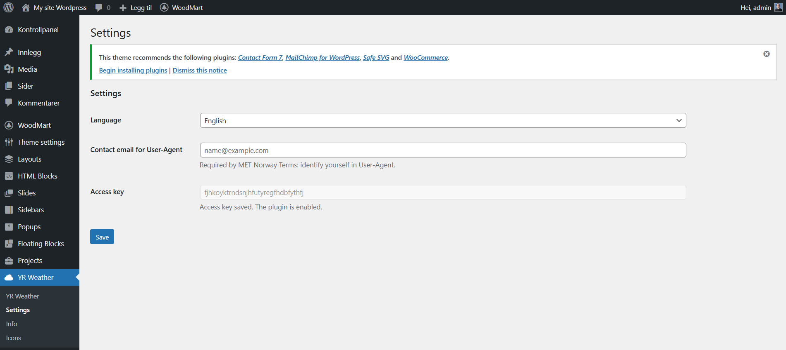
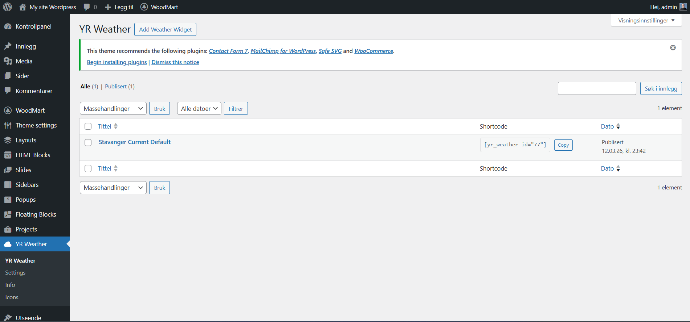
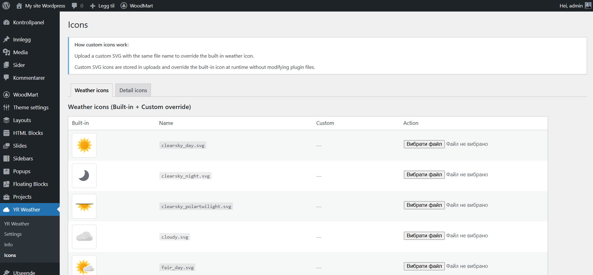

# YR Weather Pro

## Installation And Updates

1. Download `yr-weather-pro.zip` from the latest [release](https://github.com/Andrusi4ka/YR-Weather-PRO/releases).
2. In WordPress go to `Plugins -> Add New -> Upload Plugin`, upload the zip and activate it.

Newer versions then appear under `Plugins` like any other update. Widgets and settings are stored in the database and are kept across updates.

To publish a version: raise `Version` and `YRWP_VERSION` in `yr-weather-pro.php`, `Stable tag` and the changelog in `readme.txt`, commit, then push a tag `vX.Y.Z`. The release workflow builds `yr-weather-pro.zip` and attaches it to the release.

## 1. What This Plugin Is and What It Is For

**YR Weather Pro** is a WordPress plugin for building weather widgets based on data from **MET Norway / yr.no**. The plugin allows an administrator to create multiple separate weather blocks and configure, for each one, the coordinate source, forecast period, display template, field set, styles, and output method on the site.

The plugin is designed for cases where you need to:

- display the current weather or a forecast for several days;
- use multiple independent widgets on the same site;
- insert weather data into pages, posts, or templates via shortcode;
- work both with a fixed location and with visitor geolocation;
- use ready-made templates and fully control HTML via Manual templates;
- replace default SVG icons with custom ones;
- cache API responses through WordPress Transients;
- work with API data through a REST endpoint as well.

The plugin is not a "simple widget" in the narrow sense. In practice, it is a small weather block management system built around its own **Custom Post Type** `yrwp_widget`.

## 2. Where the Plugin Gets Its Data

The plugin uses two external APIs:

### 2.1. Weather Forecast

- Primary forecast API: `https://api.met.no/weatherapi/locationforecast/2.0/compact`
- Request implementation: `includes/class-yrwp-met.php`
- Method: `MET::fetch_compact(float $lat, float $lon)`

What it does:

- builds the URL from `lat` and `lon`;
- performs `wp_remote_get()`;
- sends a custom `User-Agent`;
- decodes the JSON response;
- returns a normalized array `['ok' => true|false, ...]`.

### 2.2. City Search and Reverse Timezone Detection

- City search: `https://geocoding-api.open-meteo.com/v1/search`
- Time zone for coordinates: `https://api.open-meteo.com/v1/forecast?timezone=auto`
- Implementation:
  - `Admin::ajax_city_search()` in `includes/class-yrwp-admin.php`
  - `MET::fetch_timezone_for_coordinates()` in `includes/class-yrwp-met.php`

What it is used for:

- city autocomplete in the admin panel;
- storing `city_lat`, `city_lon`, `city_timezone`;
- detecting the location timezone to support current local time tokens.

## 3. General Plugin Architecture

Plugin entry point:

- `yr-weather-pro.php`

During `plugins_loaded`, `yrwp_boot()` is called, which initializes `\YRWP\Plugin::instance()`.

Main bootstrap:

- `includes/class-yrwp-plugin.php`

It loads and starts:

- `CPT::init()` - registration of the weather widget post type;
- `Admin::init()` - settings menu, global options, AJAX city search;
- `Icons::init()` - custom icons page;
- `Shortcode::init()` - shortcode `[yr_weather id="..."]` and frontend scripts;
- `Rest::init()` - REST endpoints for weather and data.

## 4. Core Logic

### 4.1. Data Model

The plugin stores data in two places:

- **Global settings** in `wp_options`, key: `yrwp_options`
- **Widget settings** in `wp_postmeta`, meta key: `_yrwp`

Stored in `yrwp_options`:

- `user_agent_email`

Stored in `_yrwp` for each weather widget:

- `enabled`
- `title_show`
- `show_credit`
- `location_mode`
- `lat`, `lon`
- `city_name`, `city_lat`, `city_lon`, `city_timezone`
- `refresh`
- `period`
- `template_map`
- `custom_class`
- `custom_css`
- `custom_short_text`
- `custom_long_text`
- `manual_templates`
- `today_manual_step`
- `manual_show_units`
- `manual_show_today_7`
- `manual_show_today_9`

### 4.2. Weather Widget Lifecycle

1. The administrator creates a post of type `yrwp_widget`.
2. In the metabox, they configure the period, template, coordinates, cache, manual templates, and so on.
3. The plugin stores the metadata in `_yrwp`.
4. The administrator inserts the shortcode `[yr_weather id="ID"]`.
5. When the shortcode is rendered:
   - the widget is loaded via `get_post()`;
   - metadata is read via `CPT::get_meta()`;
   - `enabled` is checked;
   - the active template is determined;
   - the coordinate source is determined;
   - either cached or fresh weather data is loaded;
   - the data is passed to the template loader.
6. On the frontend, HTML is returned directly into the page or, for visitor geolocation, loaded via REST.

### 4.3. Caching

The plugin actively uses **WordPress Transients**.

Cache types:

- widget weather data: `yrwp_cache_{widget_id}_{md5(lat:lon)}`
- timezone by coordinates: `yrwp_timezone_{md5(lat:lon)}`

Characteristics:

- `refresh` is set in seconds;
- the minimum TTL in code for weather data is `max(60, $ttl)`;
- timezone data is cached for `WEEK_IN_SECONDS * 4`;
- when a widget is saved, `delete_transient('yrwp_cache_' . $post_id)` is called, but the main runtime cache includes an additional coordinate hash, so the cleanup is partial rather than complete.

### 4.4. Visitor Geolocation

If `visitor_geo` is selected for the widget:

- the shortcode outputs a container in a loading state;
- `assets/frontend.js` requests `navigator.geolocation`;
- after coordinates are received, the `yrwp/v1/weather` REST endpoint is called;
- a ready-made widget HTML response is returned;
- the HTML is inserted into the DOM.

### 4.5. Localization

The plugin's texts follow the WordPress language (the user's language in the admin, the site language on the site) and exist in three languages; any other language gets English:

- English (`en`)
- Norsk Bokmal (`nb`)
- Ukrainian (`uk`)

Class:

- `includes/class-yrwp-i18n.php`

It is responsible for:

- UI text translations;
- weather parameter names;
- symbol code descriptions;
- value formatting;
- formatting dates, short dates, and weekday names;
- Info page content;
- hints for Manual template tokens.

## 5. All Plugin Features

### 5.1. Multiple Weather Widgets

The plugin works through the `Custom Post Type`:

- `yrwp_widget`

This means:

- you can create many weather blocks;
- each block has its own configuration;
- each block has its own shortcode;
- widgets do not depend on one another.

### 5.2. Forecast Periods

4 modes are supported:

- `current` - current weather
- `today` - hourly forecast for today
- `7` - 7-day forecast
- `9` - 9-day forecast

### 5.3. Display Templates

Each period has 4 template types:

- `default`
- `compact`
- `manual`
- `json`

What this means:

- **default** - the plugin's standard HTML template;
- **compact** - a compact design variant;
- **manual** - fully controlled HTML via tokens;
- **json** - returns a JSON representation of the data instead of regular HTML.

### 5.4. Manual Templates

Manual templates are one of the plugin's key features.

The administrator can define custom HTML for:

- `current`
- `today`
- `today_item`
- `7`
- `7_item`
- `9`
- `9_item`

Characteristics:

- templates are edited directly in the admin panel;
- PHP is not executed inside templates;
- `{{ ... }}` token substitution is used;
- there is help for available tokens;
- tokens can be copied by clicking;
- the WordPress Code Editor is used for HTML and CSS.

Examples of tokens:

- `{{ title }}`
- `{{ weather_icon }}`
- `{{ weather_text }}`
- `{{ temperature }}`
- `{{ wind }}`
- `{{ humidity }}`
- `{{ pressure }}`
- `{{ forecast-time }}`
- `{{ updated_at }}`
- `{{ hourly_blocks }}`
- `{{ daily_blocks }}`
- `{{ now-time }}`
- `{{ location-now-time }}`

### 5.5. JSON Templates

JSON templates allow using the widget as a source of structured data.

Available templates:

- `template-current-json.php`
- `template-today-json.php`
- `template-7-json.php`
- `template-9-json.php`

Use cases:

- integration with another frontend;
- headless or hybrid rendering;
- debugging the forecast structure;
- passing weather data to custom components.

### 5.6. Custom CSS Styles

For non-JSON templates, you can add custom CSS:

- field `custom_css`
- on the frontend this CSS is inlined into `<style>`

You can also add:

- `custom_class` - a custom CSS class for the widget container

### 5.7. Custom Texts

In Manual modes, the following are available:

- `Short text`
- `Long text`

`Long text` is edited through `wp_editor()`, so it supports basic WordPress formatting.

### 5.8. Icons

The plugin has two categories of SVG icons:

- **Weather icons** - MET weather symbol code icons
- **Detail icons** - detail icons for temperature, wind, humidity, pressure, and so on

Capabilities:

- use built-in SVGs;
- override them with custom SVGs from uploads;
- replace icons without editing plugin files;
- a separate icon administration page: upload an SVG with any file name in the row of the icon it replaces (it is saved under that icon's name);
- safe SVG sanitization before saving.

### 5.9. City Autocomplete

For `location_mode = city`, city search is available:

- text input;
- AJAX in WordPress admin;
- request to the geocoding API;
- filling `city_name`, `city_lat`, `city_lon`, `city_timezone`.

### 5.10. Browser Geolocation

There are two scenarios:

- in the widget editor, the `Use my current location` button inserts coordinates into the fields;
- in frontend `visitor_geo` mode, coordinates are obtained from the visitor's browser and the forecast is loaded through REST.

### 5.11. Theme Template Overrides

The plugin supports overriding template files from the theme.

Override path:

- `/wp-content/themes/your-theme/yr-weather-pro/template-{slug}.php`

If the file exists in the theme, it takes precedence over the file inside the plugin.

## 6. Where and How Rendering Works

Main rendering is handled in:

- `includes/class-yrwp-shortcode.php`

Key tasks of this class:

- shortcode registration;
- frontend CSS/JS enqueueing;
- template file selection;
- fallback to the default template;
- enriching meta with timezone data;
- building the JSON payload;
- render helper functions;
- handling Manual token placeholders;
- updating the live-time token in the browser.

### 6.1. Coordinate Sources

3 modes are supported:

- `manual_coords`
- `city`
- `visitor_geo`

Logic:

- `manual_coords` uses `lat/lon` from meta fields;
- `city` uses `city_lat/city_lon`;
- `visitor_geo` does not render the forecast immediately and waits for coordinates from the browser.

### 6.2. What Gets Rendered on the Frontend

The plugin outputs:

- a widget container;
- the widget title, if enabled;
- custom CSS, if the template is not JSON;
- then either HTML or JSON, depending on template mode;
- for visitor geolocation, a loading state followed by HTML insertion through JS.

## 7. Plugin REST API

Class:

- `includes/class-yrwp-rest.php`

### 7.1. Endpoint for Weather HTML

Route:

- `GET /wp-json/yrwp/v1/weather`

Parameters:

- `id` - required widget ID
- `lat`, `lon` - the visitor's coordinates; used only by a widget in visitor geolocation mode, rounded to 2 decimals (about 1 km). Other widgets always use their saved location.

Returns:

- `ok`
- `html`
- or `error`

Use case:

- visitor geolocation on the frontend

### 7.2. Endpoint for Structured Data

Route:

- `GET /wp-json/yrwp/v1/data`

Parameters:

- `id` - required
- `period` - optional
- `lat`, `lon` - optional; as for `/weather`, used only by a visitor geolocation widget

Returns:

- JSON payload for the requested period

## 8. Plugin Admin Menu

Top-level menu:

- **YR Weather**

The following items work inside this menu:

### 8.1. Settings

Slug:

- `yrwp_main`

Purpose:

- global plugin settings

Fields:

- `Contact email for User-Agent`

Logic:

- email is added to the User-Agent for the MET API;



### 8.2. Weather Widgets (CPT List)

Post type:

- `yrwp_widget`

In the WordPress menu, this post type appears as a submenu under `YR Weather`.

Available from here:

- a list of all weather widgets;
- editing an existing widget;
- creating a new widget;
- shortcode in the list column.



### 8.3. Widget Edit Screen

This is the most important interface in the plugin.

The main `Widget Settings` metabox contains:

- `Enabled`
- `Forecast period`
- `Template`
- `Location source`
- `City`
- `Manual coordinates`
- `Update frequency`
- `Show title`
- `Custom CSS class`
- `Custom CSS`
- `Manual template` fields for different periods
- `Hourly block template`
- `Day block template`
- `Measurement units`
- `Show today day`
- `Short text`
- `Long text`

Separate sidebar metabox:

- shortcode with a copy button

The interface dynamically hides or shows fields depending on:

- the selected period;
- the selected template mode;
- the selected source mode.

For example:

- Manual fields are shown only for the `*-manual` template;
- custom CSS is hidden for JSON templates;
- city fields are shown only for `city`;
- lat/lon fields are shown only for `manual_coords`.


### 8.4. Icons

Slug:

- `yrwp_icons`

Purpose:

- view built-in SVGs;
- upload custom SVGs;
- override built-in icons;
- remove custom overrides;
- separate tabs for weather icons and detail icons.

Tabs:

- `Weather icons`
- `Detail icons`

Characteristics:

- custom SVGs are stored in uploads;
- the plugin's built-in files are not modified;
- detail icons show the corresponding placeholder token;
- SVGs are sanitized before saving.




### 8.5. Info

Slug:

- `yrwp_info`

Purpose:

- display plugin explanations;
- describe the API, icon paths, and technical reference;
- output the version footer and branding.

The page content is built from:

- `I18N::info_content()`


## 9. Plugin Structure

Below is the current structure at the level of major directories and key files:

```text
yr-weather-pro-8.3/
├── README-1.md
├── README.md
├── uninstall.php
├── yr-weather-pro.php
├── assets/
│   ├── admin.js
│   ├── frontend.js
│   ├── images/
│   │   ├── Relevant-logo.png
│   │   ├── screen-1.png
│   │   ├── screen-2.png
│   │   ├── ...
│   ├── icons/
│   │   ├── details/
│   │   │   ├── humidity.svg
│   │   │   ├── pressure.svg
│   │   │   ├── temperature.svg
│   │   │   ├── wind_direction.svg
│   │   │   ├── wind_speed.svg
│   │   │   └── ...
│   │   └── weather/
│   │       └── svg/
│   │           ├── clearsky_day.svg
│   │           ├── cloudy.svg
│   │           ├── rain.svg
│   │           └── ... many weather SVG icons
│   └── style/
│       ├── admin.css
│       ├── frontend.css
│       └── templates/
│           ├── template-7-compact.css
│           ├── template-7-default.css
│           ├── template-9-compact.css
│           ├── template-9-default.css
│           ├── template-current-compact.css
│           ├── template-current-default.css
│           ├── template-default.css
│           ├── template-today-compact.css
│           └── template-today-default.css
├── includes/
│   ├── class-yrwp-admin.php
│   ├── class-yrwp-cpt.php
│   ├── class-yrwp-i18n.php
│   ├── class-yrwp-icons.php
│   ├── class-yrwp-met.php
│   ├── class-yrwp-plugin.php
│   ├── class-yrwp-rest.php
│   ├── class-yrwp-shortcode.php
│   └── manual-token-help-map.php
└── templates/
    ├── template-current-default.php
    ├── template-current-compact.php
    ├── template-current-manual.php
    ├── template-current-json.php
    ├── template-today-default.php
    ├── template-today-compact.php
    ├── template-today-manual.php
    ├── template-today-json.php
    ├── template-7-default.php
    ├── template-7-compact.php
    ├── template-7-manual.php
    ├── template-7-json.php
    ├── template-9-default.php
    ├── template-9-compact.php
    ├── template-9-manual.php
    ├── template-9-json.php
    ├── template-default.php
    └── template-compact.php
```

## 10. Purpose of the Main Files

### `yr-weather-pro.php`

- plugin header;
- path and URL constants;
- boot logic.

### `includes/class-yrwp-plugin.php`

- loading all main classes;
- centralized plugin startup;
- helper for template location/rendering.

### `includes/class-yrwp-admin.php`

- registration of the Settings and Info menus;
- global settings;
- AJAX geocoding city search;
- admin asset enqueueing.

### `includes/class-yrwp-cpt.php`

- registration of `yrwp_widget`;
- metaboxes;
- metadata saving;
- shortcode box;
- template preview modal;
- help for Manual tokens.

### `includes/class-yrwp-shortcode.php`

- frontend rendering;
- template loading;
- manual token interpolation;
- JSON payload builder;
- render helper methods;
- live time token support.

### `includes/class-yrwp-rest.php`

- REST routes;
- REST responses for HTML and JSON;
- resolve widget context;
- resolve coordinates.

### `includes/class-yrwp-met.php`

- integration with external APIs;
- User-Agent;
- fetching compact forecast;
- timezone lookup;
- transient cache.

### `includes/class-yrwp-icons.php`

- weather/detail icons;
- custom overrides;
- upload/delete SVG;
- SVG sanitization.

### `includes/class-yrwp-i18n.php`

- translations;
- formatting;
- reference content for the Info page;
- names of fields and weather descriptions.

### `assets/admin.js`

- Code Editor initialization;
- city autocomplete;
- browser geolocation for lat/lon fields;
- token copying;
- shortcode copying;
- template preview modal.

### `assets/frontend.js`

- visitor geolocation;
- REST endpoint call;
- HTML injection;
- live time token support in the browser.

### `uninstall.php`

- deletes `yrwp_options`;
- deletes all `yrwp_widget` records;
- deletes transient cache;
- also clears site option / multisite transient records.

## 11. Templates and Styles

### 11.1. PHP Templates

Directory:

- `templates/`

Contains templates for:

- current
- today
- 7 days
- 9 days
- default / compact / manual / json

### 11.2. CSS Templates

Directory:

- `assets/style/templates/`

Contains separate styles for most default/compact templates. This avoids overloading a single universal CSS file with a large number of conditions.

## 12. Where Icons Are Stored

Built-in icons:

- weather: `assets/icons/weather/svg/`
- details: `assets/icons/details/`

Custom overrides:

- weather: `wp-content/uploads/yrwp-icons/`
- details: `wp-content/uploads/yrwp-detail-icons/`

How it works:

- if a file with the same name exists in uploads, it takes priority;
- if no custom file exists, the built-in one is used;
- the detail icon URL is built through `Icons::get_detail_icon_url()`.

## 13. Data, Compatibility, and Removal

### 13.1. Plugin Removal

During uninstall:

- global options are deleted;
- all weather widgets are deleted;
- transient cache records are deleted;
- for multisite, records in `sitemeta` are also cleared.

### 13.2. Legacy Compatibility

The code includes support for the legacy marker `14`, which is converted to `9`.

This is visible in:

- `CPT::get_meta()`
- `Rest::LEGACY_NINE_DAY_KEY`

So the plugin has already gone through a historical migration from the 14-day variant to the 9-day one.

## 14. Version History

Below is the change history collected from the `README-1.md` file.

> Important note: `README-1.md` already contains an entry for version **8.4** with primitive activation through 32 characters, but the current plugin header in `yr-weather-pro.php` still shows **Version: 8.3** and the constant `YRWP_VERSION = 8.3.0`. In other words, the development history and the current version header are currently out of sync.

### 1.x

- **1.0** Base version:
  - separate admin menu item in WordPress;
  - tabbed interface;
  - required email for User-Agent;
  - multiple weather blocks through CPT;
  - shortcode with automatic copying;
  - manual coordinates, city search, visitor geolocation;
  - selection of weather parameters;
  - full API response mode;
  - custom CSS class;
  - custom CSS with syntax highlighting;
  - cache settings;
  - display of update date and time;
  - readable names for parameters and weather conditions;
  - REST endpoint for geolocation;
  - caching through Transients.

### 2.x

- **2.0** Added icons.
- **2.1** Added icon enable/disable and size settings.
- **2.2** Removed the size field when icons are disabled.
- **2.3** Added the ability to upload and edit icons.
- **2.4** Improved icon rendering in the admin panel.
- **2.5** Removed the Add button when no icon is selected.
- **2.6** Added explanations for custom icons and reduced their size in the admin panel.
- **2.7** Removed the Edit button next to custom icons.

### 3.x

- **3.0** Added forecasts for 1, 7, and 9 days.
- **3.1** Fixed field display.
- **3.2** Added display of hourly forecast for upcoming time slots.
- **3.3** Added display of all selected parameters for future forecasts.
- **3.4** Added different templates.

### 4.x

- **4.0** Created a separate display template for each period.
- **4.1** Fixed template display so only templates for the selected period are shown.

### 5.x

- **5.0** Improved the standard template.
- **5.1** Removed unnecessary templates.
- **5.2** Added classes for fields in weather output.
- **5.3** Added the project structure to README.
- **5.4** Added a custom input and text in the admin panel.
- **5.5** Added the ability to override the template and field placement.
- **5.6** Fixed icon output.
- **5.7** Made custom field output in the template controllable.
- **5.8** Small fixes.
- **5.9** Added a checkbox for showing hours and a time format selector.
- **5.10** Slightly fixed output in the admin panel.
- **5.11** Added a Manual template for each period.
- **5.12** Hid unnecessary fields for Default and Compact.
- **5.13** Prepared the Compact template and documented potential style and short text issues.

### 6.x

- **6.0** Added detail icons, but without full integration yet.
- **6.1** Started outputting detail icons and separated styles.
- **6.2** Added editing for Current weather: Manual via tokens.
- **6.3** Removed unnecessary detail/time display checkboxes because that moved into placeholders.
- **6.4** Added custom detail icons.
- **6.5** Added a Manual template for today's weather.
- **6.6** Fixed placeholders.
- **6.7** Fixed today's hourly forecast.
- **6.8** Fixed output and styles.
- **6.9** Fixed bugs.
- **6.10** Created the design for the Default day weather template.
- **6.11** Fixed day weather templates.
- **6.12** Created the next templates; only Manual for 7 and 9 days remained.
- **6.13** Created Manual for 7 and 9 days; only styles remained.

### 7.x

- **7.0** Small bug fixes.
- **7.1** Added enable/disable for measurement units in Manual mode.
- **7.2** Fixed styles for custom CSS and HTML in the admin panel.
- **7.3** Added the Info menu with explanations.
- **7.4** Fixed the icon bug for the full forecast period.
- **7.5** Replaced 14 with 9 throughout the project.
- **7.6** Unified the multi-day forecast appearance.
- **7.7** Added more tokens for Manual 7- and 9-day templates.
- **7.8** Added Compact templates for 7 and 9 days.
- **7.9** Fixed admin styles and added a toast for token copying.
- **7.10** Added editable long text.
- **7.11** Displayed the shortcode in the weather options list.
- **7.12** Added plugin language switching.
- **7.13** Added template preview.
- **7.14** Added a current-time token.
- **7.15** Added full data cleanup on uninstall.
- **7.16** Added the ability to update the plugin without deletion.
- **7.17** Added translations for tokens.

### 8.x

- **8.0** Added tokens with short weekday names.
- **8.1** Added the ability to disable showing today for 7- and 9-day views.
- **8.2** Removed the update mechanism.
- **8.3** Added a location local time token.
- **8.4** Added primitive activation: any 32 characters must be entered for the plugin to work.

## 15. Summary

YR Weather Pro is a feature-rich WordPress weather plugin that combines:

- management of many widgets through CPT;
- integration with MET Norway;
- geolocation;
- REST;
- JSON data representation;
- Manual HTML templates with tokens;
- custom SVG icons;
- multilingual interface;
- caching through WordPress;
- a fairly flexible visual customization system.

For maintenance and future development, it is important to remember:

- the plugin has many UI conditions that depend on the period and template type;
- a significant part of the behavior is implemented in `Shortcode` and `CPT`;
- activation via a 32-character key is currently local and is not a real licensing system.
